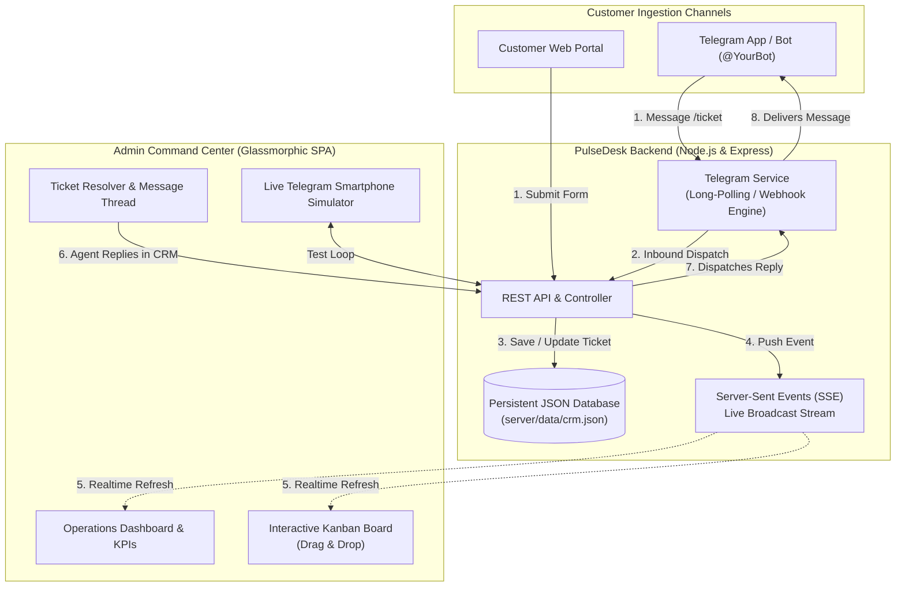

# PulseDesk CRM ⚡
> **Next-Generation Omnichannel Customer Support & Telegram Helpdesk CRM**

PulseDesk is a high-performance, real-time Customer Relationship & Support Ticket Management platform engineered with a cyber-modern glassmorphic interface, complete Telegram Bot two-way synchronization, drag-and-drop Kanban triaging, and real-time executive analytics.

---

## 🌟 Key Features

1. **Executive Operations Center**
   - **Real-Time KPI Dashboards**: Active queue volume, Telegram chat distribution, resolution velocity, SLA breaches, and CSAT ratings (98.4%).
   - **Live Charts**: Weekly influx trajectory, department volume breakdown, and response times powered by Chart.js.

2. **Dual-Mode Ticket Management**
   - **Kanban Board**: Drag-and-drop tickets between `OPEN`, `IN_PROGRESS`, `WAITING_CUSTOMER`, `RESOLVED`, and `CLOSED`.
   - **List / Table View**: Fast filtering by priority (`URGENT`, `HIGH`, `MEDIUM`, `LOW`), department, origin channel, and full-text search.
   - **Interactive Ticket Drawer**: Real-time back-and-forth chat history between customers and support engineers.
   - **Internal Staff Notes**: Confidential staff notes highlighted with yellow borders and security badge.
   - **One-Click Canned Responses**: Pre-loaded instant replies for rapid troubleshooting.

3. **Seamless 2-Way Telegram Bot Integration**
   - **Auto-Ticket Creation**: When a customer chats with the bot on Telegram, a ticket is automatically generated in PulseDesk.
   - **Live Bi-Directional Chat**: Support agents reply directly in PulseDesk, and the bot immediately delivers the reply to the customer's Telegram chat!
   - **Telegram Commands Supported**:
     - `/start`: Interactive welcome concierge.
     - `/ticket <issue>`: Opens a support ticket.
     - `/status <PD-1001>`: Checks status and latest message on an existing ticket.
     - `/help`: Command directory.
   - **In-Browser Smartphone Simulator**: Side-by-side interactive Telegram phone simulator allowing you to test customer interactions instantly even before configuring a BotFather token!

4. **Customer Self-Service Portal**
   - Dedicated public-facing portal for customers to submit tickets, track existing issues with Ticket IDs, or access Telegram support.

5. **Customer & Agent Roster**
   - Customer Directory with company tags, VIP tiers, and linked Telegram handles.
   - Agent queue tracking and automated lowest-queue ticket assignment.

---

## 📐 Architecture & System Flow



---

## 🚀 Quick Start Guide

### 1. Prerequisites
- **Node.js**: v18.0.0 or higher (Tested on Node.js v24.15)
- **Git**

### 2. Installation
```bash
# Clone the repository
git clone https://github.com/purvesh90/CRM.git
cd CRM

# Install dependencies
npm install
```

### 3. Environment Configuration (Optional)
Copy `.env.example` to `.env`:
```bash
cp .env.example .env
```
Inside `.env`:
```env
PORT=3000
TELEGRAM_BOT_TOKEN=1234567890:ABCdefGHIjklMNOpqrsTUVwxyz
```
*(Note: If no token is provided, PulseDesk will run in Simulator Mode, allowing you to test everything via the in-browser Telegram phone mockup).*

### 4. Running the Application
```bash
npm start
```
Open your browser and navigate to:
```
http://localhost:3000
```

---

## 🤖 How to Connect Your Real Telegram Bot in 60 Seconds

1. Open **Telegram** and search for `@BotFather`.
2. Type `/newbot` and follow the prompts to choose a bot name and username (e.g. `MyPulseDeskBot`).
3. Copy the **HTTP API Token** provided by BotFather.
4. In PulseDesk CRM:
   - Navigate to the **Telegram Integration** tab on the left sidebar.
   - Paste your token into the **Bot API Token** field.
   - Click **Save & Connect Bot**.
5. Your bot is now live! Open your bot in Telegram, send `/start`, and watch tickets appear in PulseDesk in real time.

---

## 📁 Repository Structure

```
CRM/
├── .env.example              # Environment variable template
├── .gitignore                # Git exclusions
├── package.json              # Project metadata & dependencies
├── README.md                 # System documentation & diagrams
├── server/
│   ├── index.js              # Express app, REST routes, SSE broadcaster
│   ├── db.js                 # Persistent JSON database & seed data
│   ├── telegram.js           # Telegram Bot polling, webhook & simulation service
│   └── data/
│       └── crm.json          # Database store (auto-generated)
└── public/
    ├── index.html            # Main UI (Admin Center & Customer Portal)
    ├── css/
    │   └── styles.css        # Glassmorphic dark design system & tokens
    └── js/
        ├── app.js            # Coordinator, navigation, SSE listener
        ├── tickets.js        # Kanban engine, drag-and-drop, ticket drawer
        ├── telegram.js       # Telegram integration & phone mockup simulator
        └── analytics.js      # Chart.js analytics engine
```

---

## 📡 REST API Reference

| Endpoint | Method | Description |
| :--- | :--- | :--- |
| `/api/tickets` | `GET` | List tickets with filters (`status`, `priority`, `channel`, `search`) |
| `/api/tickets` | `POST` | Create a new ticket |
| `/api/tickets/:id` | `GET` | Get ticket details and conversation thread |
| `/api/tickets/:id` | `PATCH` | Update status, priority, department, or assignee |
| `/api/tickets/:id` | `DELETE` | Delete ticket |
| `/api/tickets/:id/messages` | `POST` | Post agent/customer reply (auto-forwards to Telegram) |
| `/api/customers` | `GET` | List customer directory |
| `/api/agents` | `GET` | List support team members & queue stats |
| `/api/analytics` | `GET` | SLA compliance, CSAT, and department analytics |
| `/api/telegram/status` | `GET` | Bot connectivity status |
| `/api/telegram/token` | `POST` | Update and verify Telegram bot token |
| `/api/telegram/simulate` | `POST` | Test inbound Telegram messages via web simulator |
| `/api/events` | `GET` | Server-Sent Events stream for real-time frontend updates |

---

## 🛡️ License
MIT License. Built for modern customer support teams.
